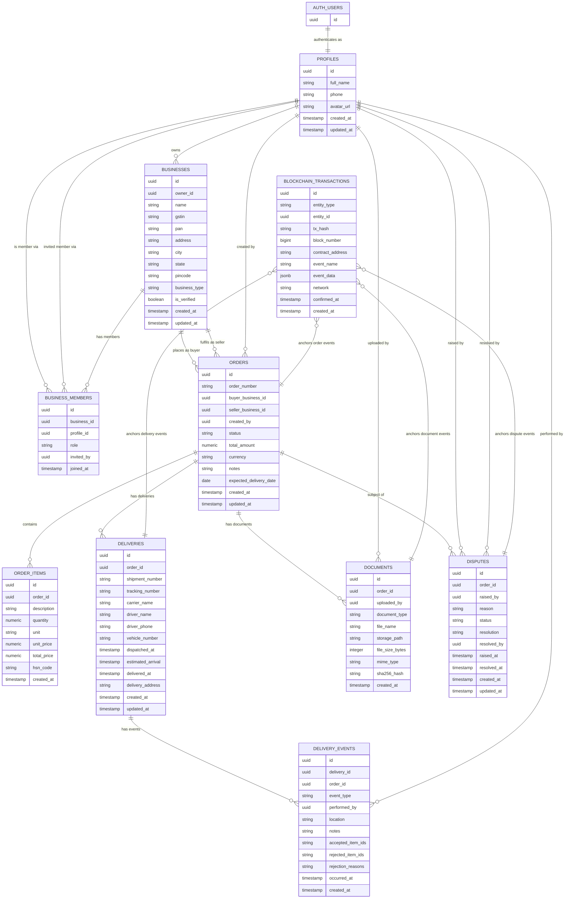

# Database ER Diagram

This diagram illustrates the full entity-relationship model for the MSME Delivery & Acceptance Ledger, backed by PostgreSQL via Supabase. It covers all tables — from authentication and business profiles through orders, deliveries, documents, disputes, and on-chain audit records — along with their primary keys, foreign keys, and cardinality relationships.

---

## Relationship Legend

| Notation | Meaning |
|---|---|
| `\|\|--\|\|` | **One-to-one** — exactly one record on each side (e.g., one Order has exactly one Delivery) |
| `\|\|--o{` | **One-to-many** — one record on the left, zero or more on the right (e.g., one Business has many Orders) |
| `}o--\|\|` | **Many-to-one** — many records on the left reference one on the right (inverse of one-to-many) |

> Crow's foot notation: `|` = exactly one, `o` = zero or one, `{` / `}` = many (zero or more).

---

## Key Design Notes

- **UUID primary keys everywhere** — all tables use `uuid` PKs generated server-side, which is Supabase-idiomatic and avoids sequential-ID enumeration attacks.
- **`auth.users` ↔ `profiles` separation** — authentication identity lives in Supabase Auth (`auth.users`); application-level profile data (name, phone, avatar) lives in a separate `profiles` table linked 1-to-1, keeping auth concerns isolated from business logic.
- **Multi-tenancy via `businesses` + `business_members`** — a single user profile can belong to multiple businesses with different roles; a `UNIQUE(business_id, profile_id)` constraint prevents duplicate membership rows.
- **Buyer/seller duality on `orders`** — the `orders` table holds two FK references to `businesses` (`buyer_business_id` and `seller_business_id`), allowing both parties to be first-class entities without duplicating the order model.
- **`order_items.total_price` is a generated column** — computed as `quantity × unit_price` by the database, eliminating the risk of application-layer calculation drift.
- **`deliveries` is one-to-many with `orders`** (each shipment distinguished by `shipment_number`) while `delivery_events` is one-to-many with `deliveries`, cleanly separating the static delivery record from its audit-trail of location/status events.
- **Cascade deletes on child tables** — `order_items`, `delivery_events`, and `documents` all declare `ON DELETE CASCADE` from `orders`, ensuring no orphan rows when an order is removed; `deliveries` and `disputes` do not cascade, preserving forensic data.
- **Polymorphic `blockchain_transactions`** — the `entity_type` + `entity_id` pair provides a schema-agnostic way to anchor an on-chain transaction to any domain entity (order, delivery, document, etc.) without requiring per-entity FK columns or separate junction tables.
